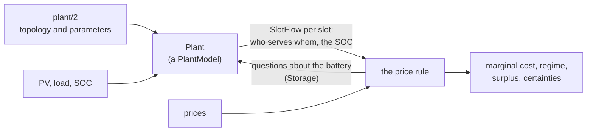

# The plant model

The price of a kWh depends on what the plant will do with it: charge the battery,
export, import. So the engine needs a model of the plant that projects where every kWh
goes, slot by slot. That model sits behind a port: the price rule asks it questions and
never what the plant is, so one price rule serves every topology.

The plant model is a package of its own, `microgrid.plant`. It is useful beyond the
price, and loads nothing of the price model ([Use the plant model on its
own](../how-to/plant-alone.md)).

## What the port holds

- **`PlantModel.project`**: given the slots, PV, load and the SOC now, the flows of
  each slot (`SlotFlow`): PV to the house, to the battery, exported, curtailed; the
  battery to the house; the grid to the house and to the battery; the SOC at each slot's
  end. It also reports its dispatch's bookkeeping (whether the plant holds the battery,
  how far a top-up is from its target), which the price rule reads.
- **`PlantModel.storage`**: the battery as the price rule asks about it (`Storage`):
  its reserve and saturation, whether it can charge or discharge more in a slot, how
  much PV a load could divert from charging it, how many kWh it stores of a kWh charged
  from each source by the path that source takes (`stored_per_kwh`: what the stored cost
  books a charge at), and what a stored
  kWh is worth through its conversion and wear. None for a
  plant without a battery.
- **The meters**: how the plant's meters read, so the same rule can run over what was
  metered.

Topology (where PV and the battery connect, the inverters' conversion, the dispatch,
the meters) is the plant model's alone. The price rule asks path-aware questions, and
each topology answers for its own conversion.

## The library's plant model

`microgrid.plant.Plant` is one configurable model, not one class per topology:
it takes a `PlantConfig` (`plant/2`) and runs every configuration through one dispatch.
That dispatch is **self-consumption with PV charging first**, slot by slot:

1. PV serves the house (and the inverters' own draw).
2. PV left over charges the battery.
3. In a grid-charge window, the grid tops the battery up toward its target.
4. PV still left is exported; above an export limit it is curtailed.
5. The battery serves what PV did not, within its limits; the grid serves the rest.

The configuration adds what a plant does beyond that: grid-charge windows, battery
export windows, holding the battery through a DC-bus load's session, the grid's import
and export limits, inverter ratings. [`plant/2`](../reference/plant.md) lists them, and
[Describe your plant](../how-to/describe-plant.md) shows each topology.

## It models the plant's own rules, not an optimum

The plant model predicts what the plant **will** do under its own rules. It does not
decide what the plant should do, and it does not assume a plan nothing executes. A kWh's
value depends on what actually dispatches the battery: energy a plant will export at
midday for little is worth little to it, however much an optimizer could have earned
with it in the evening.

That is why the engine takes [dispatch as modelled](inputs.md#dispatch-as-modelled) as
an input: when the plant is not running the dispatch its model describes, the valuation
cannot rest on the model and falls back to the import price.

## Checking it against the meters

A plant model is only worth pricing with if it does what the plant does:
[check it against the meters](../how-to/check-plant.md).

## Your own model

Any object that keeps the `PlantModel` protocol can stand in for `Plant`, and
`microgrid.engine.testing.assert_plant_model_contract` checks one. See [Write your own
plant model](../how-to/own-plant-model.md).
