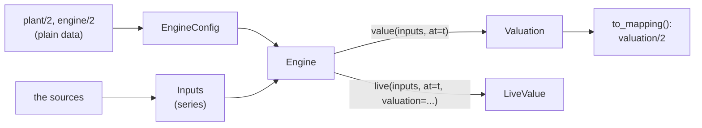

# Use the library from Python

Build the configuration once, hand the engine series, and read what comes back.



## 1. The engine

```python
from datetime import UTC, datetime, timedelta
from zoneinfo import ZoneInfo

from microgrid.engine import Engine, EngineConfig, Inputs
from microgrid.engine.ledger import Amount, Lots, Source
from microgrid.plant import Plant, PlantConfig
from microgrid.engine.series import Forecast, Interval, Price, Quantiles, Sample, Series

tz = ZoneInfo("Europe/Madrid")
plant = Plant(PlantConfig.from_mapping({
    "schema": "plant/2",
    "timezone": "Europe/Madrid",
    "pv": [{"name": "roof", "coupling": "ac"}],
    "battery": {
        "capacity_kwh": 10.0, "charge_kw": 5.0, "discharge_kw": 5.0,
        "eta_charge": 0.95, "eta_discharge": 0.95, "reserve_soc": 0.1,
        "wear_charge_per_kwh": 0.02, "wear_discharge_per_kwh": 0.02,
        "connection": "ac", "inverter": {"ac_rating_kw": 5.0},
    },
}, tz=tz))
engine = Engine(EngineConfig.from_mapping({"schema": "engine/2"}, plant=plant))
```

- `PlantConfig.from_mapping` takes `plant/2` as plain data: parse TOML, JSON or
  YAML and pass the result. The zone is a `ZoneInfo` you build.
- `EngineConfig.from_mapping` takes `engine/2`; `{"schema": "engine/2"}` is every
  default. Both raise an error naming every problem with its path.

## 2. The inputs

Every input is a series ([Series and forecasts](../concepts/series.md)). A forecast
input is a series of issues, each at the time you received it:

```python
now = datetime(2026, 6, 10, 6, 0, tzinfo=UTC)          # 08:00 in Madrid
slots = [now + timedelta(minutes=30 * k) for k in range(96)]


def forecast[V](values: list[V], source: str) -> Forecast[V]:
    """Half-hourly values from now, as one issue made now."""
    return Forecast(
        tuple(Interval(s, s + timedelta(minutes=30), v) for s, v in zip(slots, values)),
        issued_at=now,
        source=source,
    )


def received[V](issue: Forecast[V], unit: str) -> Series[Forecast[V]]:
    """A series of one issue, received now."""
    return Series((Sample(now, issue),), known_until=now, unit=unit)


def pv_kw(t: datetime) -> float:                       # a stand-in for a real forecast
    hour = t.astimezone(tz).hour
    return 4.0 if 10 <= hour < 18 else 0.0


# What the battery holds: 3.5 stored kWh of yesterday's solar, charged while export
# earned 0.05 (cost per AC kWh charged; 0.95 stored per AC kWh). A ledger gives this.
solar = Amount(3.5, 3.5 / 0.95 * 0.05)
lots = Lots(now, {Source.PV: solar}, pool=solar)


inputs = Inputs(
    prices=received(forecast([Price(0.20, 0.05)] * 96, "my-tariff"), "EUR/kWh"),
    pv=received(forecast(
        [Quantiles({0.1: 0.5 * pv_kw(s), 0.5: pv_kw(s), 0.9: 1.1 * pv_kw(s)}) for s in slots],
        "my-pv-forecast"), "kW"),
    load=received(forecast([0.5] * 96, "my-load-forecast"), "kW"),
    soc=Series((Sample(now, 0.35),), known_until=now),         # a fraction, 0-1
    dispatch_as_modelled=Series((Sample(now, True),), known_until=now),
    lots=Series((Sample(now, lots),), known_until=now),
)
```

- **Every time is UTC.** Convert at the edge; the engine refuses anything else.
- **Values are in the engine's units**: kW, an SOC as a fraction, prices per kWh.
  `microgrid.engine.units.normalise` converts a measured series from its source's unit
  (`units.normalise(soc_percent, "fraction")`); convert forecast values as you build
  them, as `microgrid.cli.inputs` does for a dataset.
- **Leave out what the plant does not have**: no `pv` for a plant without PV, no `soc`
  or `dispatch_as_modelled` without a battery. Passing one raises.
- **Keep every issue you receive**, in the order you received it, if you want to value
  past moments later: the engine reads each input as it stood at the moment you ask
  about.
- **Give the battery's lots** (`Inputs.lots`): a series of `Lots`, each in force from
  when the ledger (`microgrid.engine.ledger`) booked it
  ([Inputs](../concepts/inputs.md#the-batterys-lots)). Here the battery holds solar
  charged at 0.05, so a kWh from it costs 0.05 through its losses and wear, 0.0754.
  Without lots, all it holds is priced as bought at the import (0.20), the valuation
  names `battery_lots` in `degraded`, and its values stand: here the sun refills the
  battery first, so a battery kWh would cost 0.0976.

## 3. A valuation

```python
valuation = engine.value(inputs, at=now)
print(valuation.kind, valuation.degraded, len(valuation.slots))
first = valuation.slots[0]
print(first.start, first.marginal_cost, first.regime, first.certainty_spill)
```
```text
stored_value_v1 () 288
2026-06-10 06:00:00+00:00 0.07540166204986153 battery 1.0
```

Check `valuation.kind` before using the slots: `fallback_import` means an input could
not be used (the slots are then at the import price, the causes in `degraded`), and
`unpriced` means there are no slots at all ([Causes and kinds](../reference/causes.md)).

`engine.value` reads nothing received after `at`. Calling it with a past `at` over the
recorded inputs is a replay that cannot look ahead.

## 4. As plain data

```python
import json

print(json.dumps(valuation.to_mapping()["slots"][0]["supply"]))
```
```text
[{"source": "battery", "kw": 4.5, "per_kwh": 0.0754016620498615}, {"source": "grid", "kw": null, "per_kwh": 0.2}]
```

`to_mapping()` gives dicts, lists, numbers and strings, times in ISO 8601 with their
offset: the [`valuation/2`](../reference/valuation.md) schema. Publish it, store it, or
validate it against the schema the library ships
(`microgrid/engine/schemas/valuation-2.schema.json`, or `microgrid schema`).

## 5. The live value

Between valuations, run the latest one again from the meters
([The live value](../methodology/live-value.md)):

```python
later = now + timedelta(minutes=10)
readings = [now + timedelta(seconds=30 * k) for k in range(21)]


def measured(kw: float) -> Series[float]:
    return Series(tuple(Sample(t, kw) for t in readings), known_until=later, unit="kW")


live = engine.live(
    Inputs(
        prices=None,
        soc=Series((Sample(now, 0.35), Sample(later, 0.34)), known_until=later),
        dispatch_as_modelled=Series((Sample(now, True),), known_until=later),
        lots=Series((Sample(now, lots),), known_until=later),
        meters={"pv": measured(0.0), "grid": measured(0.0), "battery": measured(-0.5)},
        measured_load=measured(0.5),
    ),
    at=later,
    valuation=valuation,
    valid_until=now + timedelta(minutes=30),
)
print(live.kind, live.marginal_cost, live.surplus_kw, live.regime, live.degraded)
```
```text
stored_value_v1 0.07540166204986153 0.0 battery ()
```

- `meters` are keyed by the plant's meter names (`pv`, `grid`, `battery` by default),
  each in its configured sign: here the battery reads -0.5 kW, discharging.
- `valid_until` is required with a valuation: past it, the live value falls back and
  names `issue`.
- Keep the readings for `engine.config.smoothing_window` (50 minutes by default)
  before the moment, and the one in force then.
- A client with its own reasons to distrust a value (a dropped connection) passes them
  as `external=[...]`.

A client that gets readings one at a time can let the engine keep them:
`session = engine.live_session()`, then `session.update(reading, valuation,
valid_until)` per reading, where `reading` is a `LiveReading`:

| Field | What |
|---|---|
| `at` | the reading's time, UTC |
| `load_kw` | the [house load](../concepts/inputs.md#house-load), kW; None if unknown |
| `soc` | the SOC, 0-1; None if unknown, and always for a plant without a battery |
| `dispatch_as_modelled` | [dispatch as modelled](../concepts/inputs.md#dispatch-as-modelled); None if unknown |
| `meters` | each meter's kW by its `plant/2` name, in its sign; a missing meter is unknown |
| `external` | the client's own causes, if any |

## Next

- [Replay and score a period](replay.md): many valuations over a past span.
- The [API reference](../reference/api/engine.md): every public name.
