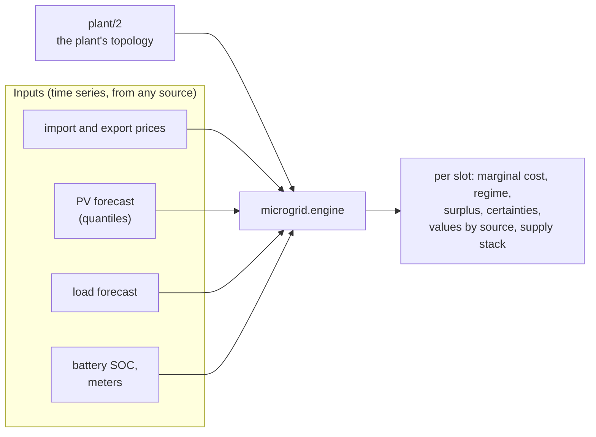

# microgrid

**microgrid models a solar + battery plant and produces marginal energy prices:** what
one more kWh costs the site, slot by slot over the next two days, and what a kWh is
worth by source. A flexible load, or a scheduler for one, reads those prices to decide
when to run.

It is a Python library: it takes the plant's description and its inputs as time series.

`plant/2` is the plant's description ([reference](reference/plant.md)); each output is
defined in [Outputs](concepts/outputs.md).

## What makes it different

- **It prices the next kWh, not the average one.** A kWh used in a slot comes from one
  source: PV that would have been exported, the grid, or the battery. The price is that
  source's: the export given up, the import, or the battery's energy. The price follows
  the plant forward to find out which, slot by slot.
  [The methodology](methodology/index.md) explains how.
- **It knows what the battery holds.** A kWh from the battery costs what its energy
  cost: the day's solar at the export it gave up, the night's grid energy at what it
  was bought for, through the battery's losses and wear. And a full battery with sun
  ahead is priced to be used: kept full, it would waste the day's PV.
- **It prices the weather's uncertainty.** The price is an average over PV scenarios,
  published with a pessimistic case and the chance it holds.
- **It degrades conservatively.** A missing or stale input moves the price toward the
  import price and says why. A stale discount is never reused.

## Where to start

- **Try it.** [Install](install.md), then [run your first
  valuation](how-to/first-valuation.md) on the example dataset: one synthetic week of an
  example plant, no hardware needed.
- **Understand it.** [The methodology](methodology/index.md), from "why one more kWh"
  to what a battery kWh costs and the PV scenarios.
- **Use it on your plant.** [Describe your plant](how-to/describe-plant.md), [build a
  dataset](how-to/build-dataset.md) from your own records, or [call it from
  Python](how-to/python.md).
- **Look something up.** The [reference](reference/index.md): the formats, the
  `microgrid` command and the API.
- **A term you don't know** (SOC, DC bus, hybrid inverter, ...): the
  [glossary](glossary.md).

## The parts

| Part | What |
|---|---|
| `microgrid.engine` | the library: the plant model, the price model, the battery's [lots](methodology/lots.md), the series and units its inputs arrive in, the checks against the meters |
| `microgrid.cli` | the `microgrid` command: the library run on a dataset (`dataset/1`) of files, or on a site's live sources (`sources/1`; the `sources` extra). |
| `examples/dataset` | one synthetic week of an example plant, with the outputs the repository's tests check the command against. |

microgrid is pre-release: [install it](install.md) from its git repository.
