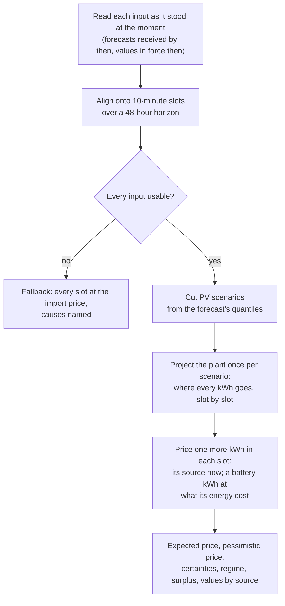

# How inputs become prices

## The question

> If I use one more kWh in this slot, what does it cost my site?

A scheduler for a flexible load asks this for every slot of the next two days and runs
the load where the answer is low. The answer is rarely the import price:

- **On a sunny afternoon with a full battery**, one more kWh is PV that would have been
  exported, so it costs the export you give up.
- **On the evening after**, the battery serves the house with the day's solar. A kWh
  from it costs the export that solar gave up, plus the round trip's loss and the
  battery's wear: about 0.10 in the [worked day](make-up-rule.md#a-worked-day), against
  an evening peak of 0.45.
- **After a night of charging from the grid**, the battery holds energy bought at the
  night rate, and a kWh from it costs about that, plus the losses: 0.22 for energy
  bought at 0.18.
- **A battery filled from the grid, with a sunny day ahead**, costs about the export
  price. Kept full, it would leave no room for the day's sun; drawn down, the sun
  refills it.

The library works out which, slot by slot.

## The steps

1. **Read the inputs as they stood.** Each forecast as received by the moment, each
   measured value in force then. Nothing received later is read, so a replay of the past
   cannot look ahead ([Series and forecasts](../concepts/series.md)).
2. **Align them onto [slots](../concepts/slots-horizon.md)**: 10 minutes each, 48 hours
   ahead by default.
3. **Check every input can be used.** If one cannot, the valuation falls back to the
   import price and names why ([Missing and stale inputs](degradation.md)).
4. **Cut PV scenarios.** The forecast's quantiles (Solcast's p10, p50 and p90: powers the
   PV falls short of one time in ten, half the time and nine times in ten; or any other
   levels with the median) become ten equally likely PV days ([PV scenarios and
   certainty](scenarios.md)).
5. **Project the plant.** For each scenario, the [plant model](../concepts/plant-model.md)
   says where every kWh goes: to the house, the battery, the grid.
6. **Price one more kWh in each slot by what serves it.** PV spilling now costs the
   export it gives up; an import, the import price. A kWh from the battery's cycle costs
   what the energy in the battery cost, run forward along the projection, plus the
   discharge's loss and wear ([What a stored kWh is worth](stored-value.md)).
7. **Look ahead for a fill.** Where the sun will refill the battery before it needs the
   grid, a kWh drawn costs no more than that sun: a full battery must not be kept full
   at the cost of the day's PV ([The make-up rule](make-up-rule.md)).
8. **Average over the scenarios**, and say how sure the average is.

## The pages

| Page | The question it answers |
|---|---|
| [The marginal price](marginal-price.md) | Why price one more kWh, and not the average one? |
| [What a stored kWh is worth](stored-value.md) | What a battery kWh costs, and why it is what its energy cost |
| [The make-up rule](make-up-rule.md) | What makes up a kWh taken from the battery, and when that sets the price |
| [PV scenarios and certainty](scenarios.md) | How an uncertain forecast becomes one price |
| [Regimes and surplus](regimes-surplus.md) | How a slot's regime and surplus are read from the projection |
| [The battery's lots](lots.md) | Where the energy in the battery came from, and what it cost |
| [The live value](live-value.md) | The price now, from the meters, between valuations |
| [Missing and stale inputs](degradation.md) | Why a missing input moves the price toward the import price |
| [Scope](scope.md) | What a client brings, and what the library can't model |
| [Requirements](requirements.md) | What the library holds itself to (R-1 to R-9) |

