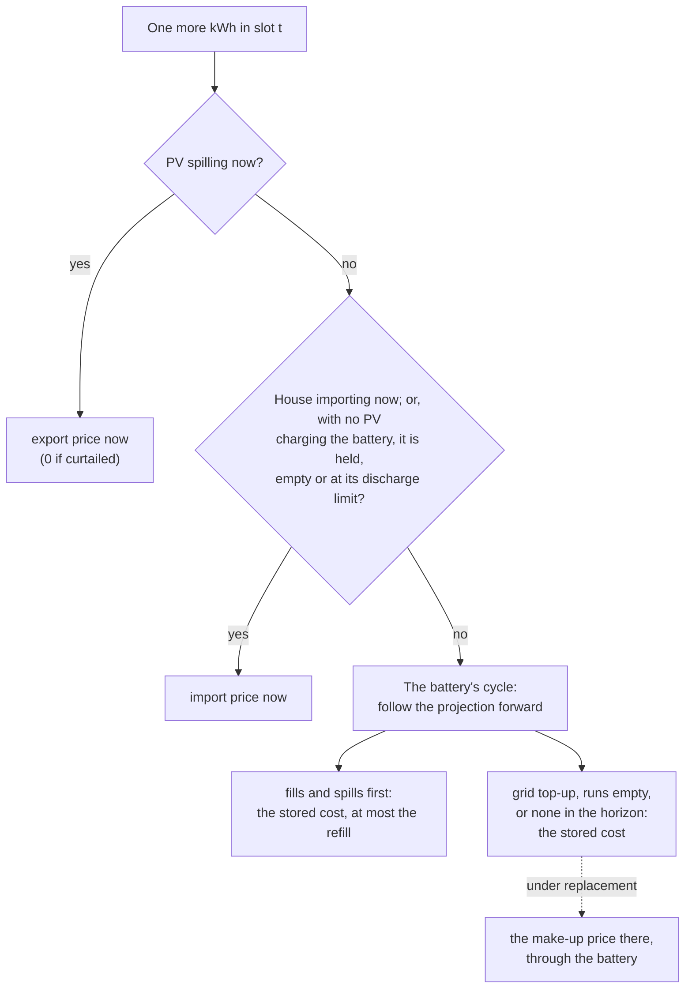

# The make-up rule

**A kWh taken from the battery's cycle now leaves the battery a kWh short later. The
make-up rule follows the plant forward to the first event that settles who makes that
kWh up: the sun, a grid top-up, or the house importing once the battery runs empty.**

Every valuation finds this event, slot by slot and scenario by scenario, and what it
finds shapes the price in two ways:

- **On the default rule** (`engine/2`'s `battery_value = "stored_cost"`), a battery kWh
  costs [what the energy in the battery cost](stored-value.md). The event bounds it in
  one case: **where the first event is a fill**, the sun refills the room a draw frees,
  so a kWh drawn costs no more than that sun. The events also set `certainty_spill`,
  `displaces` and the regime.
- **Under `battery_value = "replacement"`**, the event prices the battery's cycle
  outright: a kWh costs what makes it up, carried through the battery's losses and
  wear. The rest of this page describes that rule, and the tables give both.

## Why the default does not price by the replacement

A replacement is a forecast. On a dull morning the projection may say the plant will
refill the battery from the grid in the afternoon, and the make-up rule then prices a
morning kWh at that purchase, through the battery: 0.37 a kWh on [the worked day
below](#a-worked-day), above the 0.30 import price at the time. But the plant may not
make that purchase: a brighter afternoon than forecast refills the battery from the sun
instead. What the energy in the battery cost is known now; what will replace it is not.
So by default the morning kWh costs what the battery's energy cost (0.10 there: it holds
solar), and the replacement only bounds the price where it is the sun.

## A kWh now, a kWh less later

A kWh a flexible load uses in a slot comes from one of three places:

- **PV that is spilling now** (exported or curtailed): the load takes it, and the site
  gives up that export.
- **The grid, now**: the house is already importing, so the kWh is one more import.
- **The battery's cycle**: the load takes PV that was charging the battery, or the
  battery discharges a kWh more. Either way the battery ends the slot one kWh lower than
  it would have.

The first two are priced in the slot itself. The third is the battery's: PV diverted
costs the export now (the import, where the grid tops the battery up in the same slot),
and a battery kWh costs its stored cost, on the default rule;
under `replacement` both are paid for whenever the battery makes up the missing kWh. So
the rule follows the plant's projection forward.

## The events

From the slot, look ahead through the projection to whichever happens first:

| First event after the slot | What the missing kWh means there | Its make-up price |
|---|---|---|
| **The battery fills and spills** | it reaches full a kWh later, so a kWh less is exported then | that slot's export price (0 where the PV is curtailed) |
| **The plant tops the battery up from the grid** (a [grid-charge window](../glossary.md#grid-charge-window)) | the plant buys one more kWh | that slot's import price |
| **The battery runs empty** | the house imports one more kWh by then | the cheapest import from the slot until it runs empty ([why](#the-empty-event-the-cheapest-import-before-the-need)) |
| **None, within the horizon** | it is made up after the horizon | [the horizon rule](#the-horizon-rule) |

*Held*: the plant keeping the battery from discharging, while it tops it up, keeps it
at a window's target, or holds it through a DC-bus load's session.

**Why "first".** The battery either fills, tops up or runs short; whichever comes first
absorbs the missing kWh. After a fill the battery is full either way; after a top-up to
a target it is at the target either way; after running empty it is empty either way.
Nothing later sees the difference.

**The fill: the export price at the first spill.** A kWh taken earlier delays the moment
the battery is full by one kWh's worth, so the kWh lost is the one at the start of the
spill, whatever the export price does later. This is the event the default rule reads:
the refill is solar that would have spilled, so a battery kWh costs no more than that.

**The top-up: the import price where the top-up binds.** If the plant will charge from
the grid to reach a target, every kWh taken before then is one more kWh it buys there.

### The empty event: the cheapest import before the need

When the battery runs empty, the house imports. A kWh taken from the battery earlier
means the house imports one more kWh before the battery is refilled. Under
`replacement` the rule prices that kWh at **the cheapest import price from the slot
until the battery runs empty**, with no battery losses or wear on top.

The reason is a substitution, not a purchase into the battery. Between now and the empty
moment the battery serves the house in every slot. In the cheapest of those slots, the
house could take one kWh from the grid instead of from the battery; the battery then
keeps that kWh, and covers the kWh the load took. No extra kWh is charged into the
battery and none goes round it, so the battery adds neither loss nor wear. That is the
difference from a top-up, where the plant really charges one more kWh and it does go
round the battery.

The plant left to itself may not make that substitution: it may import the kWh when the
battery runs empty, at a dearer hour. The price is then the least the missing kWh needs
to cost, not what the plant will pay unaided. Inside the expensive hours, with no
cheaper hour left before the battery empties, the two agree: the kWh costs that hour's
price.

### The horizon rule

When no event falls within the horizon, the make-up is priced at **the lowest import
price either from the slot to the horizon's end, or within the horizon's last 24 hours,
whichever is lower**. Prices beyond the horizon are not known, so the last day's prices
stand in for the day after it: the kWh could be bought back at the cheapest of them.

## A worked day

A plant with AC-coupled PV and a 10 kWh battery: 5 kW each way, a 10 %
[reserve](../glossary.md#reserve), 95 % efficient each way, wear 0.02 per kWh each way.
Times are the plant's local times.
The house draws a steady load. Import costs 0.18 overnight (00:00-06:00), 0.30 by day,
0.45 from 16:00 to 21:00 and 0.30 after; export earns 0.07. What the battery holds at
07:00 is given as lots: the previous day's solar, charged while export earned 0.07. The
tables come from running the library on this plant. *Make-up* is the price at the event; *published* is the slot's
`marginal_cost` on the default rule; *replacement* is the same slot under
`battery_value = "replacement"`.

**A sunny day.** The battery is at 40 % at 07:00, fills by late morning and spills all
afternoon; the house draws 0.5 kW.

| Slot | What the plant is doing | First event | Make-up | Published | Replacement |
|---|---|---|---|---|---|
| 09:00 | PV charging the battery | fills at 10:40 | 0.07 | 0.07 | 0.07 |
| 13:30 | full, exporting | PV spilling now | 0.07 | 0.07 | 0.07 |
| 19:00 | the battery serving the house | fills again tomorrow at 10:50 | 0.07 | 0.10 | 0.12 |

Every kWh of the sunny day is solar. At 19:00 the battery holds solar that gave up 0.07
of export; through the battery that is 0.10. The make-up rule says 0.12: tomorrow's
solar refills it, and that refill pays its charge wear too.

**A dull day.** The battery is at 30 % at 07:00 and never fills; the house draws 0.7 kW.
The battery runs empty at 20:20, inside the expensive hours.

| Slot | What the plant is doing | First event | Make-up | Published | Replacement |
|---|---|---|---|---|---|
| 09:00 | the battery serving the house | empty at 20:20 | 0.30, the cheapest import from 09:00 to 20:20 | 0.10 | 0.30 |
| 14:00 | PV charging the battery | empty at 20:20 | 0.30 | 0.07 | 0.23 |
| 18:00 | the battery serving the house | empty at 20:20 | 0.45: no cheaper hour is left before then | 0.10 | 0.45 |
| 22:00 | empty, importing | importing now | | 0.30 | 0.30 |

The battery holds only solar all day, so its kWh costs what that solar cost, morning
and evening alike. The make-up rule prices the shortfall instead: a kWh taken in the
morning is one more kWh the house imports before the battery runs empty, at the day
rate, and in the peak at the peak's.

**The same dull day with a grid-charge window**, 13:00-15:00, toward 90 %:

| Slot | What the plant is doing | First event | Make-up | Published | Replacement |
|---|---|---|---|---|---|
| 09:00 | the battery serving the house | top-up at 14:20 | 0.30 | 0.10 | 0.37 |
| 14:00 | the grid topping the battery up, PV charging it too | top-up now | 0.30 | 0.30 | 0.30 |
| 18:00 | the battery serving the house | empty at 04:40 the next morning | 0.18, the night rate | 0.27 | 0.18 |

At 14:00 the top-up is under way, so PV a load diverts from charging is replaced by the
grid in that same slot: that is no forecast, and both rules price it at the import,
0.30. The top-up buys grid energy at 0.30, so from the afternoon a battery kWh is mostly
that energy: 0.27, the blend of it and the morning's solar, through the battery. The make-up
rule looks the other way: at 09:00 a kWh taken is one more kWh the top-up buys (0.37, the
[case above](#why-the-default-does-not-price-by-the-replacement)); at 18:00 the
topped-up battery carries the house into the night, and a kWh taken is made up at the
night rate.

## Other tariff shapes

The rule reads whatever price curve it is given. The same plant and days, run again:

**A flat tariff**: import 0.25 and export 0.05 at every hour; the battery's 07:00
energy is solar charged at 0.05.

| Day, slot | First event | Published | Replacement |
|---|---|---|---|
| sunny, 09:00 | fills at 10:40 | 0.05 | 0.05 |
| sunny, 22:00 | fills tomorrow at 10:50 | 0.08 | 0.10 |
| dull, 09:00 | empty at 20:20 | 0.08 | 0.25 |
| dull, 14:00 (PV charging) | empty at 20:20 | 0.05 | 0.19 |

The tariff is flat, yet the price is not: a kWh from the sun or from the battery's
solar costs 0.05 to 0.08, a kWh from the grid 0.25.

**A dynamic tariff**: a different import price every hour (0.12 at 03:00, 0.07 at
12:00, 0.42 at 18:00), export at half the import; the battery's 07:00 energy is solar
charged at 0.04.

| Day, slot | Import then | First event | Published | Replacement |
|---|---|---|---|---|
| sunny, 18:00 | 0.42 | PV spilling now | 0.21, the export it displaces | 0.21 |
| dull, 09:00 | 0.20 | empty at 20:20 | 0.06 | 0.07: the 12:00 import is the cheapest before then |
| dull, 18:00 | 0.42 | empty at 20:20 | 0.07 | 0.33: the cheapest left before then, at 20:00 |

On the dull day the battery holds solar charged at 0.04, topped up by the midday's,
charged while export earned 0.035 to 0.055: a kWh from it costs 0.06 to 0.07 morning and
evening. The make-up rule prices the shortfall instead: the dull morning at the midday
dip, because that is when the energy the battery will lack can be bought, and the
evening at the last hour before it runs empty.

## What serves the kWh in the slot itself

Before looking ahead, the rule checks the slot:

- **PV spilling now**: the kWh takes it, at the export it displaces (0 where curtailed).
  Where an export limit curtails PV, the kWh takes the curtailed PV first, worth nothing.
- **The house importing now**: the import price.
- **No PV charging the battery, and the battery has nothing to give**: it is at its
  reserve, at its discharge limit, or the plant is holding it (topping it up, keeping it
  at a target, or through a DC-bus load's session). The kWh is the grid's, at the import
  price, even though the house was not importing.

Otherwise the kWh is the battery's: PV diverted from charging it, or a kWh more
discharged. On the default rule it costs what the [stored-value
page](stored-value.md) says; under `replacement`, the event ahead prices it.

## Limits and unusual plants

- **Without a battery**, nothing stores a kWh: a kWh is PV spilling now, at the export it
  displaces, or the grid's, at the import price. Without PV either, every kWh is the
  import price.
- **At an import limit**, a kWh more cannot be imported. It is taken from PV diverted
  from charging, from the grid's charge diverted, or from the battery beyond its usual
  policy; failing all of those it is [unserved](../concepts/outputs.md#unserved), priced
  at the import price as a floor.
- **A battery-export window** (the plant discharging to the grid at set hours) adds one
  event: a kWh taken before the window ends the export run a kWh sooner, a kWh less
  exported at that slot's export price.

## What the rule does not decide

Whether, when or how much the plant charges from the grid. The grid-charge window is
part of the plant's configuration, and the rule prices the purchase it implies.
